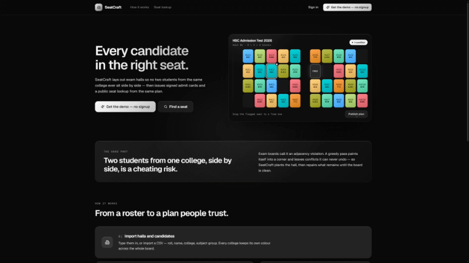

# SeatCraft

<p align="center">
  
</p>

Exam seat allocation and admit-card engine — a portfolio project modelled on the domain
of OnnoRokom Projukti's *E-Recruitment Pro*.

## The problem

Exam centres must seat thousands of candidates across dozens of halls such that no two
candidates from the same institution sit adjacent — otherwise neighbours can compare
answers. That is graph colouring on a grid, which is NP-hard.

SeatCraft solves it with DSATUR-style sequential colouring plus an iterative repair pass,
then verifies the result with an independent validator. It produces zero-violation plans
for 5,000 candidates in well under a second, then issues signed admit cards and a public
seat lookup from the same plan.

## Tech stack

<p>
  
</p>

- **Backend** — .NET 9, EF Core (SQLite in dev, Postgres in prod), JWT auth, QuestPDF,
  Serilog, xUnit + FsCheck tests, benchmarks
- **Frontend** — Next.js 16, TypeScript, React 19, Tailwind CSS 4, React Icons
- **Infra** — Docker, nginx with HTTPS, deployed on a VPS

| Folder | Contents |
|---|---|
| [`backend/`](backend/README.md) | .NET 9 API: solver, EF Core, JWT, PDFs, tests, benchmarks |
| [`frontend/`](frontend/README.md) | Next.js app: landing, workspace, seat plan editor, lookup |

## Quick start

```bash
cd backend
dotnet run --project src/SeatCraft.Api
```

Swagger UI: <http://localhost:5199/swagger>

Full setup, API reference and benchmark table: [`backend/README.md`](backend/README.md).

## Status

- [x] Domain model and allocation constraints
- [x] Solver: greedy, balanced, strict + independent validator + metrics
- [x] Solver unit tests and FsCheck property tests
- [x] Benchmark harness
- [x] EF Core persistence, migrations, tenant query filters
- [x] JWT auth, roles, tenant resolution
- [x] Exam / hall / institution / candidate APIs, CSV import
- [x] Async allocation runs, progress, cancel, idempotency, locking
- [x] Seat overrides, audit trail, optimistic rules
- [x] Admit card and attendance sheet PDFs
- [x] Public seat lookup with roll + DOB
- [x] Health checks, Serilog, Docker, CI
- [x] Next.js frontend
- [x] Live deployment
